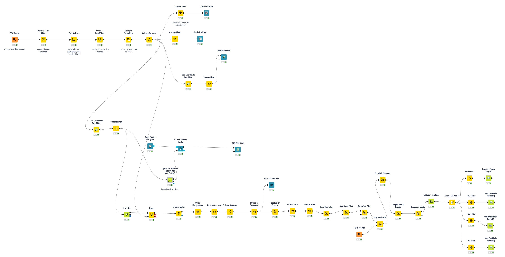
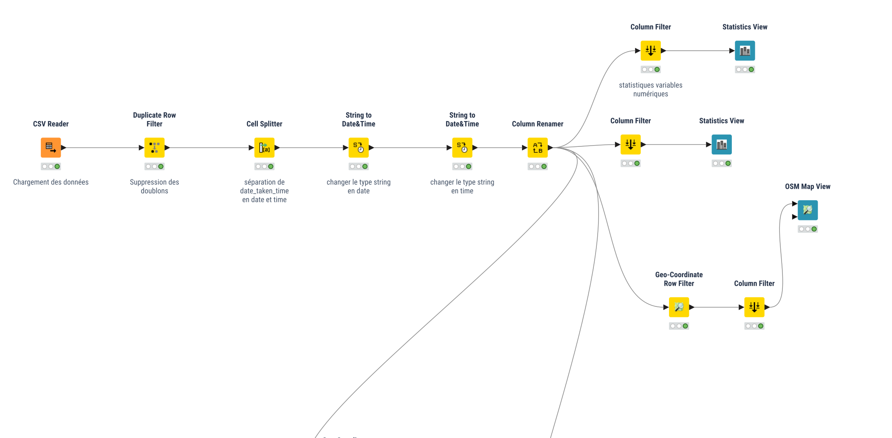
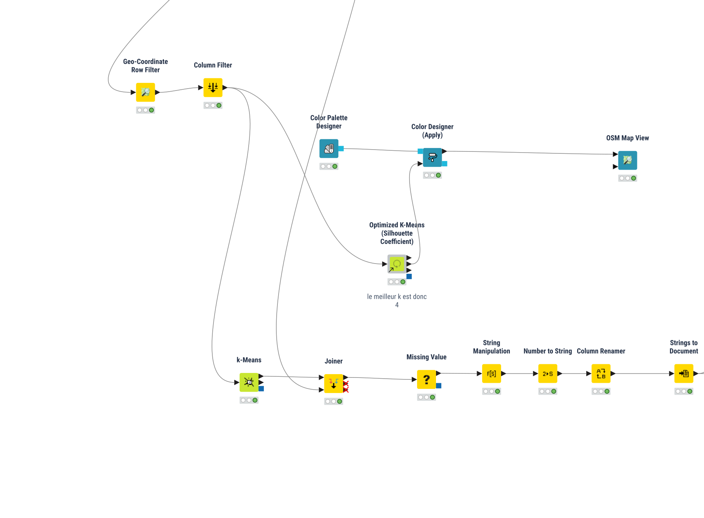
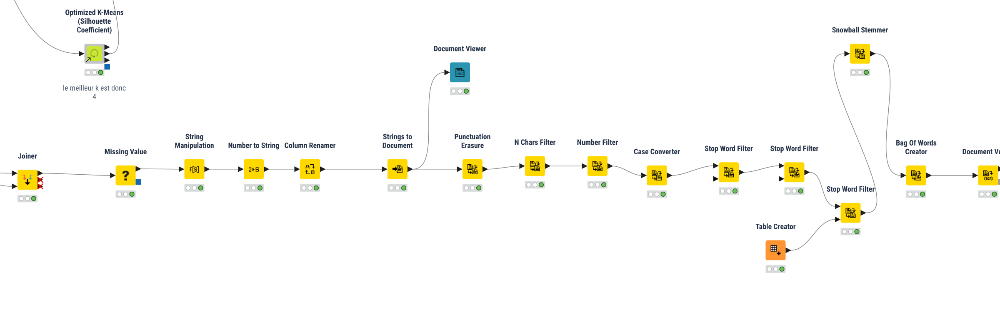
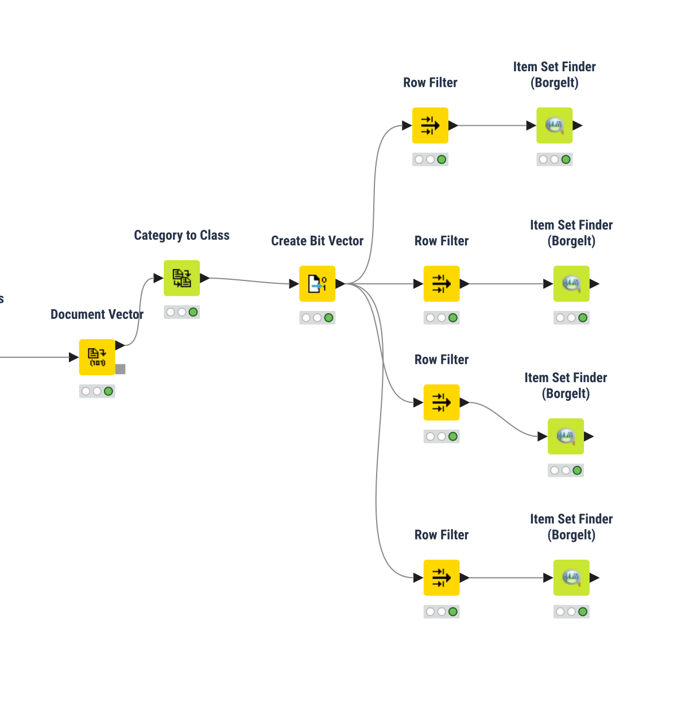

# Analyse des médias géolocalisés de Rennes Métropole

**Mini-projet de fouille de données — KNIME Analytics Platform**  
*Analyse spatiale, clustering et fouille de motifs fréquents à partir de photographies géolocalisées.*

## Présentation

Ce projet s'intéresse à des photographies géolocalisées associées au territoire rennais. L'idée est de croiser deux informations complémentaires : **où les photos ont été prises** et **comment elles sont décrites** (titres et mots-clés).

Le travail est réalisé dans **KNIME Analytics Platform**. Il suit trois grandes étapes : préparation des données, identification de groupes géographiques avec **K-Means**, puis recherche de **motifs lexicaux fréquents** pour caractériser les groupes obtenus. L'objectif n'est pas simplement de représenter des points sur une carte, mais aussi de proposer une **description en intension** des ensembles de photographies.

## Vue générale du workflow



> Cette vue est issue du fichier `workflow.svg` inclus dans l'export KNIME v1.8. Les libellés ont été conservés et rendus lisibles dans les images. Cliquez sur une capture pour l'agrandir sur GitHub.

## 1. Chargement et préparation des données



Le point de départ est le fichier **`flickrRennes.csv`**. Parmi ses attributs figurent notamment `id_photo`, `id_photographer`, `title`, `tags`, `lat`, `long` et des informations relatives à la date de prise de vue.

Le workflow réalise successivement la lecture du CSV, la suppression des doublons, la séparation des informations de date et d'heure, la conversion des types et le renommage des colonnes. Des vues statistiques sont ensuite utilisées pour examiner les variables numériques et les autres attributs pertinents.

Pour préparer l'analyse textuelle, les valeurs manquantes sont prises en charge et une variable **`text_photo`** réunit les champs `tags` et `title`.

## 2. Analyse spatiale et clustering



L'analyse spatiale s'appuie sur les coordonnées `lat` et `long` :

- **Geo-Coordinate Row Filter** : sélection des observations appartenant à la zone géographique retenue.
- **OSM Map View** : visualisation des photographies sur une carte.
- **Optimized K-Means (Silhouette Coefficient)** : comparaison de plusieurs valeurs de *k*.
- **K-Means** : affectation des photographies aux groupes géographiques.
- **Color Palette Designer / Color Designer (Apply)** : distinction visuelle des groupes sur la carte.

Dans cette version du workflow, la valeur retenue est **k = 4**. Les effectifs enregistrés dans les sorties exécutées sont les suivants :

| Groupe | Photographies | Part de l'ensemble |
|:--|--:|--:|
| `cluster_0` | 249 | 5,9 % |
| `cluster_1` | 1 685 | 40,2 % |
| `cluster_2` | 2 086 | 49,7 % |
| `cluster_3` | 175 | 4,2 % |
| **Total** | **4 195** | **100 %** |

Ces valeurs proviennent de l'état enregistré dans le fichier KNIME fourni et ne constituent pas une nouvelle exécution. Elles décrivent la répartition des **photographies conservées dans l'analyse**, et non une fréquentation touristique mesurée directement.

## 3. Prétraitement du texte



Après la jointure des informations spatiales et descriptives par `id_photo`, la colonne `text_photo` est transformée en documents avec **Strings to Document**. Le prétraitement comprend :

1. suppression de la ponctuation et filtrage des termes trop courts ou numériques ;
2. normalisation de la casse ;
3. filtrage des mots vides en français et en anglais ;
4. utilisation d'une liste personnalisée de mots à exclure, notamment pour limiter l'influence des signatures de photographes ;
5. racinisation avec **Snowball Stemmer (French)** ;
6. construction du **Bag of Words**, puis du **Document Vector**.

Le rattachement des documents à leur classe géographique permet ensuite d'étudier le vocabulaire propre à chaque cluster.

## 4. Fouille de motifs fréquents par cluster



La représentation textuelle est convertie en **vecteur binaire** avec `Create Bit Vector`. Quatre branches distinctes filtrent les documents selon leur classe (`cluster_0`, `cluster_1`, `cluster_2`, `cluster_3`). Chaque branche applique **Item Set Finder (Borgelt)**.

Dans la version fournie, l'algorithme configuré est **Apriori**, avec un **support minimal de 10 %** et des motifs de **1 à 3 items**.

| Cluster | Motifs fréquents enregistrés |
|:--|--:|
| `cluster_0` | 5 |
| `cluster_1` | 1 |
| `cluster_2` | 341 |
| `cluster_3` | 6 |

Le nombre de motifs ne suffit pas, à lui seul, à définir la signification des groupes. La **description en intension** doit s'appuyer sur les termes des itemsets réellement obtenus, leur support et leur cohérence géographique. La présence d'un seul motif dans `cluster_1`, par exemple, invite à examiner la diversité du vocabulaire et l'effet du seuil choisi, sans conclure automatiquement à l'absence de thème.

## Organisation du dépôt

```text
mini-projet-medias-geolocalises/
├── README.md
├── workflow/
│   └── Mini-Projet-v1.8.knwf
└── assets/
    ├── 01_workflow_complet.png
    ├── 02_preparation_donnees.png
    ├── 03_analyse_spatiale_clustering.png
    ├── 04_pretraitement_textuel.png
    └── 05_fouille_motifs.png
```

## Reproduire le travail

### Prérequis

- **KNIME Analytics Platform** (workflow créé avec **KNIME 5.12.0**) ;
- les extensions nécessaires aux nœuds utilisés, notamment **KNIME Textprocessing**, **KNIME Open Street Map Integration** et **KNIME Itemset Mining** ;
- le jeu de données source **`flickrRennes.csv`**, à récupérer séparément si vous ne le possédez pas.

### Importation et exécution

1. Télécharger [`Mini-Projet-v1.8.knwf`](workflow/Mini-Projet-v1.8.knwf).
2. Dans KNIME, sélectionner **File > Import KNIME Workflow**, puis choisir le fichier `.knwf`.
3. Ouvrir le nœud **CSV Reader** et remplacer son chemin local d'origine par l'emplacement actuel de `flickrRennes.csv`.
4. Installer les extensions manquantes éventuellement signalées, puis réinitialiser et exécuter le workflow de gauche à droite.
5. Consulter les vues cartographiques, les résultats de K-Means et les quatre sorties de **Item Set Finder (Borgelt)**.

**À savoir :** l'archive KNIME fournie contient le workflow et sa configuration, mais **pas le fichier CSV d'origine**. L'export possède un chemin absolu propre à l'ordinateur de création : il doit être corrigé avant toute nouvelle exécution. Les cartes peuvent nécessiter une connexion Internet pour charger leurs fonds cartographiques.

**GitHub héberge ce projet, mais n'exécute pas nativement un workflow KNIME.** L'automatisation depuis l'onglet *Actions* demande une infrastructure d'exécution KNIME compatible, à configurer séparément. Aucun déploiement automatique n'est inclus dans ce dépôt.

## Limites et pistes d'amélioration

La lecture des résultats doit tenir compte du caractère partiel et déclaratif des métadonnées photographiques. Les clusters traduisent des regroupements **spatiaux**, pas nécessairement des lieux d'intérêt distincts. De même, les motifs textuels peuvent dépendre de la longueur des titres, de la qualité des tags, du traitement des mots vides et du support minimal.

Pour prolonger le travail, il serait intéressant de documenter les termes principaux de chaque cluster, d'exporter les cartes finales et de rendre le chemin du fichier d'entrée entièrement relatif au workflow afin de faciliter sa réutilisation.

---

*Document rédigé à partir du workflow KNIME « Mini-Projet-v1.8 » fourni. Les captures correspondent à l'export graphique embarqué dans le fichier `.knwf` ; les effectifs et paramètres rapportés correspondent à ses configurations et sorties sauvegardées.*

